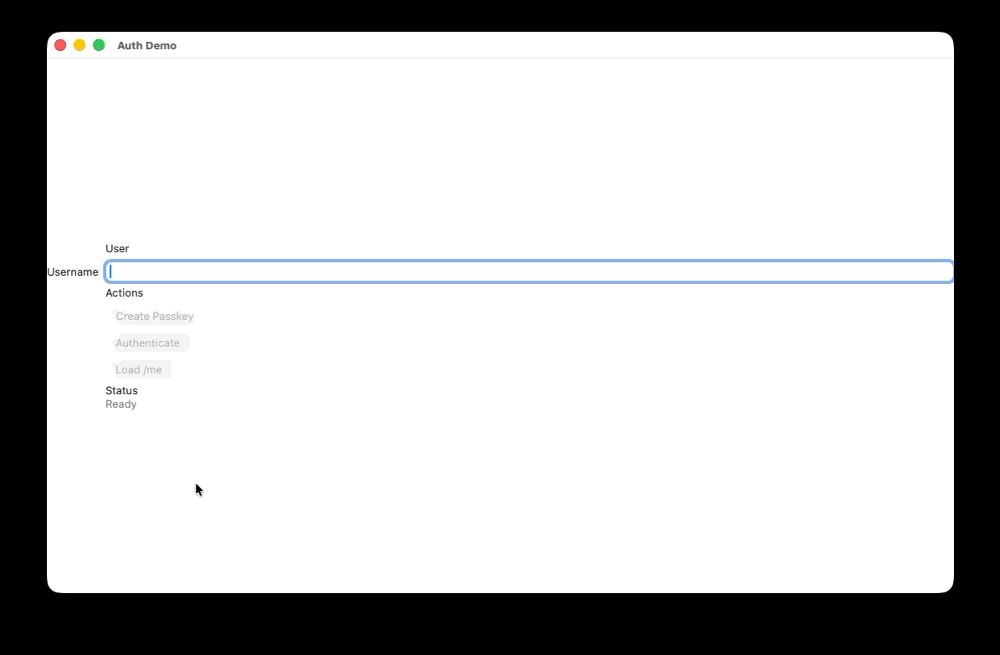

# Passkey Auth

This repository contains:

- A SwiftNIO backend auth service that supports passkey registration and authentication.
- JWT issuance after successful passkey authentication.
- In memory and DynamoDB backed persistence for passkey credentials and pending challenges.
- [AWS deployment guidance](Docs/architecture.md) for running the backend.
- A SwiftUI Apple-platform package, `AuthKit`, that creates and uses passkeys on iOS and macOS
- macOS sample app illustrating integration of `AuthKit` to authenticate with passkeys.
- static web sample illustrating use of the auth service.

## Endpoints

- `GET /`
- `GET /health`
- `POST /register/begin`
- `POST /register/complete`
- `POST /authenticate/begin`
- `POST /authenticate/complete`
- `GET /me`

### Common API behavior

- Request and response bodies are JSON.
- Binary WebAuthn values are encoded as base64url strings.
- Error responses use the same JSON envelope on every route:

```json
{
  "error": "Human-readable message"
}
```

- Successful responses include an `X-Request-ID` header.
- `GET /me` requires `Authorization: Bearer <jwt>`.

### `GET /` and `GET /health`

Purpose: health checks and simple service discovery.

Request body: none.

Successful response: `200 OK`

```json
{
  "status": "ok",
  "service": "AuthService"
}
```

### `POST /register/begin`

Purpose: start passkey registration. The server creates a short-lived WebAuthn registration challenge and returns the public-key creation options the client should pass into passkey APIs.

Request body:

```json
{
  "username": "alice@example.com",
  "displayName": "Alice"
}
```

- `username`: required. Leading and trailing whitespace is trimmed.
- `displayName`: optional. Falls back to `username` when omitted.

Successful response: `200 OK`

```json
{
  "challenge": "base64url-challenge",
  "rp": {
    "name": "Auth Demo",
    "id": "auth.example.com"
  },
  "user": {
    "id": "base64url-user-id",
    "name": "alice@example.com",
    "displayName": "Alice"
  },
  "pubKeyCredParams": [
    {
      "type": "public-key",
      "alg": -7
    }
  ],
  "timeout": 60000,
  "attestation": "none",
  "excludeCredentials": [
    {
      "type": "public-key",
      "id": "base64url-credential-id"
    }
  ]
}
```

- `challenge`: random registration challenge.
- `rp`: relying party information configured by `RP_ID` and `RP_NAME`.
- `user`: WebAuthn user identity. The `id` is generated server-side and reused for repeat registration attempts by the same username.
- `pubKeyCredParams`: supported credential algorithms. This service currently advertises ES256 (`alg: -7`).
- `excludeCredentials`: populated when that username already has a credential, which helps clients avoid creating a duplicate passkey for the same authenticator.

Possible errors:

- `400 Bad Request` if `username` is missing or the JSON body is invalid.

### `POST /register/complete`

Purpose: finish passkey registration. The client sends the attestation returned by the platform authenticator, and the server verifies the challenge, origin, relying party, and credential data before storing the public key.

Request body:

```json
{
  "username": "alice@example.com",
  "credential": {
    "id": "base64url-credential-id",
    "rawID": "base64url-credential-id",
    "type": "public-key",
    "attestationObject": "base64url-attestation-object",
    "clientDataJSON": "base64url-client-data"
  }
}
```

- `credential.id` and `credential.rawID`: the credential identifier returned by the WebAuthn client.
- `credential.type`: expected to be `public-key`.
- `credential.attestationObject`: authenticator attestation payload.
- `credential.clientDataJSON`: serialized client data used to bind the response to the challenge and origin.

Successful response: `201 Created`

```json
{
  "status": "registered"
}
```

Possible errors:

- `400 Bad Request` if the JSON is invalid or the WebAuthn payload cannot be decoded or verified.
- `409 Conflict` if the username is already registered with a different credential.
- `404 Not Found` if the matching registration challenge is missing or expired.

### `POST /authenticate/begin`

Purpose: start passkey sign-in. The server looks up the stored credential for the supplied username, creates a short-lived assertion challenge, and returns the public-key request options the client should pass into `navigator.credentials.get(...)` or the platform equivalent.

Request body:

```json
{
  "username": "alice@example.com"
}
```

Successful response: `200 OK`

```json
{
  "challenge": "base64url-challenge",
  "timeout": 60000,
  "rpId": "auth.example.com",
  "allowCredentials": [
    {
      "type": "public-key",
      "id": "base64url-credential-id"
    }
  ],
  "userVerification": "preferred"
}
```

- `challenge`: random authentication challenge.
- `rpId`: relying party identifier that the authenticator must match.
- `allowCredentials`: the registered credential IDs that may satisfy the request. This service currently returns the single stored credential for the username.
- `userVerification`: set to `preferred`, allowing authenticators to perform biometric or device-level verification when available.

Possible errors:

- `404 Not Found` if the username does not have a registered passkey.
- `400 Bad Request` if the JSON is invalid.

### `POST /authenticate/complete`

Purpose: finish passkey sign-in. The client sends the assertion produced by the authenticator, and the server verifies the challenge, signature, credential ID, and signature counter. On success it returns a signed JWT for authenticated API access.

Request body:

```json
{
  "username": "alice@example.com",
  "credential": {
    "id": "base64url-credential-id",
    "rawID": "base64url-credential-id",
    "type": "public-key",
    "authenticatorData": "base64url-authenticator-data",
    "clientDataJSON": "base64url-client-data",
    "signature": "base64url-signature",
    "userHandle": "base64url-user-handle"
  }
}
```

- `credential.authenticatorData`: signed authenticator metadata, including the signature counter.
- `credential.clientDataJSON`: serialized client data used to bind the response to the challenge and origin.
- `credential.signature`: authenticator signature over the assertion payload.
- `credential.userHandle`: optional user handle supplied by the authenticator.

Successful response: `200 OK`

```json
{
  "accessToken": "<jwt>",
  "tokenType": "Bearer",
  "expiresAt": "2026-04-01T18:30:00Z",
  "credentialID": "base64url-credential-id"
}
```

- `accessToken`: HMAC-signed JWT.
- `tokenType`: always `Bearer`.
- `expiresAt`: UTC timestamp for token expiration.
- `credentialID`: the credential used to authenticate.

The JWT contains these claims:

- `sub`: `username:credential_id`
- `username`
- `credential_id`
- `iss`
- `aud`
- `iat`
- `exp`

Possible errors:

- `404 Not Found` if the username does not have a registered passkey, or if the expected authentication challenge is missing or expired.
- `400 Bad Request` if the JSON is invalid or the assertion payload cannot be verified.

### `GET /me`

Purpose: validate a bearer token and return the authenticated user information encoded in it. This is the simplest protected endpoint in the demo and a good reference for how downstream services can consume the issued JWT.

Request headers:

```http
Authorization: Bearer <jwt>
```

Request body: none.

Successful response: `200 OK`

```json
{
  "subject": "alice@example.com:base64url-credential-id",
  "username": "alice@example.com",
  "credentialID": "base64url-credential-id"
}
```

Possible errors:

- `401 Unauthorized` if the bearer token is missing, malformed, expired, or signed with the wrong secret.

## Run locally

```bash
export RP_ID=auth.example.com
export RP_NAME="Auth Demo"
export RP_ORIGIN=https://auth.example.com
export CORS_ALLOWED_ORIGINS=https://auth.example.com
export STORE_DRIVER=memory
export JWT_SECRET=dev-secret
export AUTH_LOG_LEVEL=debug
swift run AuthService
```

The service listens on `http://0.0.0.0:8080`.
Logs are written to stdout in a structured format, which makes them easy to inspect in CloudWatch when the container is deployed on AWS.

## macOS demo

The repo includes both:

- A quick Swift Package executable target for basic UI checks
- A real Xcode app project for passkey flows that require a bundle identifier, signing, and associated-domain entitlements

[](Docs/media/macos-sample-app-demo.mov)

Click the preview above to open the full recording.

For quick smoke tests, you can still run the package target:

```bash
swift run AuthDemoMacApp
```

When launched this way, the demo is running as a Swift Package executable rather than a bundled `.app`, so macOS will not give it a custom app icon or full app-bundle behavior. The sample now promotes itself to a regular foreground app so it shows up in the Dock and menu bar, but if you want normal app packaging, signing, and an icon asset, open the package in Xcode and run the `AuthDemoMacApp` scheme there.

Passkey registration and authentication will not work from `swift run AuthDemoMacApp`. Apple requires the calling macOS process to have a real app identifier, which means running the bundled app from Xcode after you set signing.

For passkeys on macOS, use the Xcode project:

```bash
open AuthDemoMacApp.xcodeproj
```

The project is preconfigured with:

- Bundle identifier: `com.example.AuthDemoMacApp`
- Associated domains entitlement: `webcredentials:example.com`
- Info.plist-driven app config values for the backend URL, relying party ID, and default username

Before using passkeys against your own relying party, update these settings in the Xcode target build settings:

- `PRODUCT_BUNDLE_IDENTIFIER`
- `AUTH_DEMO_BASE_URL`
- `AUTH_DEMO_RP_ID`
- `AUTH_DEMO_DEFAULT_USERNAME`

Then choose your development team in Signing & Capabilities. The hosted `apple-app-site-association` file for your relying party must include `webcredentials.apps` with your final app identifier in the form `TEAMID.BUNDLE_IDENTIFIER`.

`Samples/AuthDemoMacApp/AppConfiguration.swift` still provides fallback defaults so the package executable path continues to work outside Xcode.

## Static web demo

The repo also includes a browser sample in `Samples/AuthDemoWebApp`.

It is a plain static site, so you can deploy it to any static host and point it at this auth service. For browser-based deployments, the backend now reads `CORS_ALLOWED_ORIGINS` as a comma-separated allowlist and defaults it to `RP_ORIGIN`.

For local browser testing, a good starting point is:

```bash
export RP_ID=localhost
export RP_NAME="Auth Demo"
export RP_ORIGIN=http://localhost:4173
export CORS_ALLOWED_ORIGINS=http://localhost:4173
export STORE_DRIVER=memory
export JWT_SECRET=dev-secret
swift run AuthService
```

Then serve the static sample separately from `Samples/AuthDemoWebApp`, for example with `python3 -m http.server 4173`.

## Building the Docker image

- aws login
- aws ecr get\-login-password \-\-region {REGION} | docker login \-\-username AWS \-\-password-stdin {REPO_URI}
- docker buildx build \-\-platform linux/arm64 \-\-load \-t {REPO_NAME} .
- docker tag {REPO_NAME}:{TAG} {REPO_URI}:{TAG}
- docker push {REPO_URI}:{TAG}
